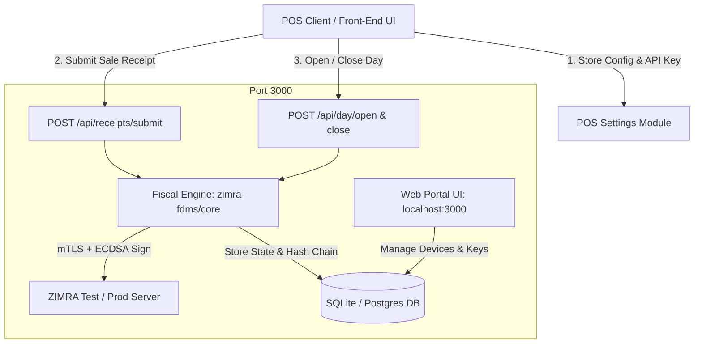

# Implementation Plan: ZIMRA FDMS Server & UI Wiring

## Objective
Launch and operationalize the **ZIMRA FDMS Multi-Tenant Gateway Server**, verify the built-in management dashboard, and establish the integration contract for wiring POS frontends and settings.

---

## Phase 1: Server Verification & Launch
- [x] **Check Environment & Dependencies**: Ensure `node_modules` and TypeScript runtime (`tsx`) are intact.
- [x] **Launch Server Process**: Start `scripts/server.ts` on port `3000` (`npm start`).
- [x] **Database Bootstrap**:
  - Verify auto-initialization of `fdms-multi-tenant.db`.
  - Verify master encryption key (`.master.key`) for AES-256-GCM private key security.
  - Verify default demo tenant creation (`demo@zimra-fdms.local`).
- [x] **Health & Status Smoke Test**: Perform a test `GET http://localhost:3000/api/status`.

---

## Phase 2: Built-in Portal UI Verification
- [x] **Open Portal in Browser**: Navigate to `http://localhost:3000`.
- [x] **Tenant Auth Validation**:
  - Test login with default tenant (`demo@zimra-fdms.local` / `password123`) or register a new tenant company.
  - Confirm API key generation (`zf_live_...`).
- [x] **Fiscal Device Console**:
  - Review device state (Device ID, Serial Number, Environment, Certificate expiration).
  - Check fiscal day indicators (Day status: Closed vs. Open, Last Receipt Global Number).
- [x] **Interactive Testbed**:
  - Run a sample receipt submission from the UI test panel.
  - Verify generated QR payload and ECDSA signature output.

---

## Phase 3: POS UI Integration Architecture
Define the configuration and endpoints required in your POS settings:

### 1. Settings / Configuration Screen
In the POS settings UI, wire the following fields:
| Setting Field | Purpose | Example Value |
| :--- | :--- | :--- |
| **FDMS Server URL** | Base URL of the fiscal gateway | `http://localhost:3000` |
| **Tenant API Key** | Secure tenant authentication token | `zf_live_3a91bf982847c0932...` |
| **Device ID / Serial** | Target device identifier | `12345` / `MYPOS01` |
| **Operating Mode** | Online with automated queuing | `Online` / `QueueOnFailure` |

### 2. POS Workflow Integration Endpoints
- **Shift Start / Fiscal Day Open**:
  - **Endpoint:** `POST /api/day/open`
  - **Header:** `X-API-Key: <tenant_key>`
  - **Payload:** `{ "deviceId": 12345 }`
- **Checkout / Sale Submission**:
  - **Endpoint:** `POST /api/receipts/submit`
  - **Header:** `X-API-Key: <tenant_key>`
  - **Payload:** Full JSON receipt structure (`currency`, `lines`, `payments`, `taxes`).
  - **Return:** `receiptGlobalNo`, `fiscalDayNo`, `qrData`, `signature`.
  - **POS Action:** Render QR code on receipt printout and store fiscal signatures in POS invoice record.
- **Shift End / Fiscal Day Close**:
  - **Endpoint:** `POST /api/day/close`
  - **Header:** `X-API-Key: <tenant_key>`
  - **POS Action:** Closes current fiscal day and synchronizes cumulative turnover counters with ZIMRA.

---

## Phase 4: End-to-End Testing & Validation
- [x] Run a complete end-to-end cycle:
  1. Open fiscal day.
  2. Post 2 sales receipts (verify consecutive hash chaining and global receipt numbering).
  3. Close fiscal day.
- [x] Test offline fault resilience: Verify local queueing behavior if the ZIMRA server or gateway is unreachable.
